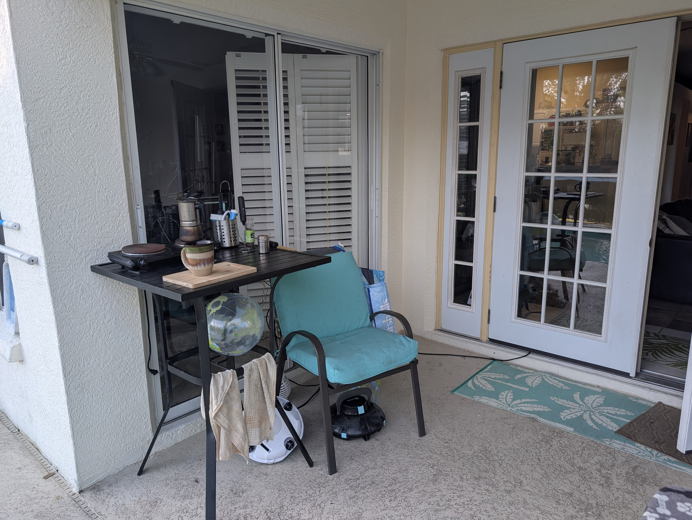
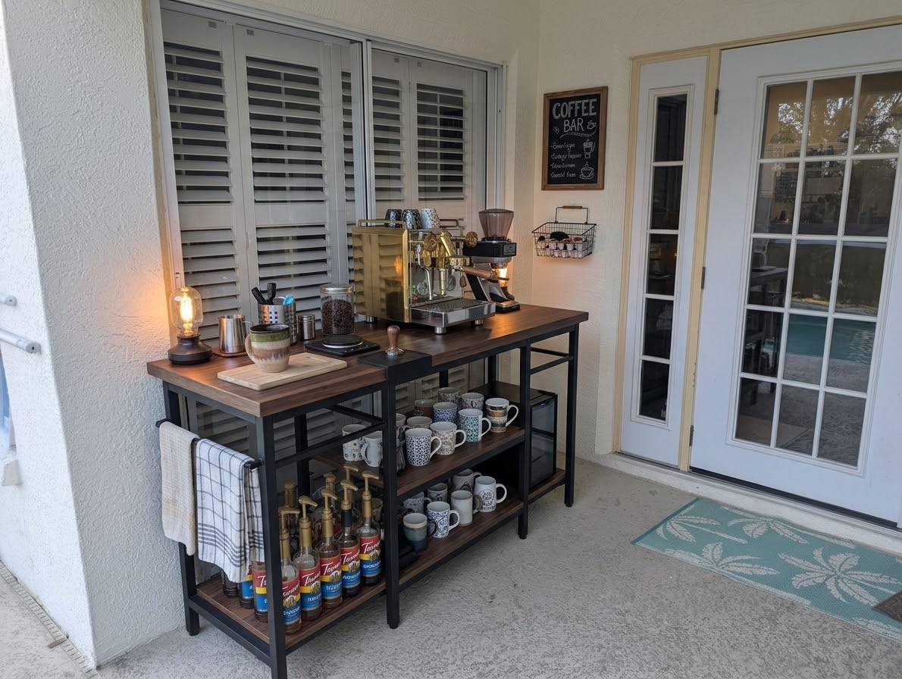
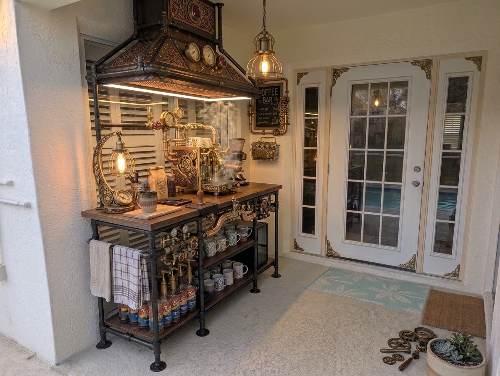

# Patio coffee bar

Told by the owner on 2026-08-16, with three images.

## What he wants

Replace the small table in the corner of the covered patio with a **larger table
to use as a coffee bar**. Stated requirements:

- A **nice table top**
- A **mini fridge** to keep milk
- Room for the **coffee machine**, the **grinder**, and **cups**

Construction idea, in his words: *"I think it'd be cool if the table was made
from wrought iron pipes?"*

## Current state

A small black metal bistro-height table in the corner of the covered patio,
against the stucco wall beside the sliding screen door and the french doors that
look onto the pool. On it: a single electric hot plate, a stovetop moka pot, a
utensil caddy, a glass bottle, a stoneware mug, and a wooden cutting board.

A teal-cushioned patio chair sits immediately beside it, and a pool-cleaning
robot and its hose are on the floor underneath and behind. Towels hang off the
table frame. The table is clearly too small for what is already on it.

## Mockups

Both were generated with Gemini and are **design references, not products** —
nothing here has been sourced or priced.

### Industrial

A long console at roughly counter height in a black square-tube frame with a
dark walnut top, sited along the same wall. Two lower shelves hold mugs and a
row of Torani syrup bottles; a **small glass-fronted fridge** sits in the right
bay. On top: an espresso machine with a portafilter, a burr grinder, a bean jar,
a scale, a tamper, a milk pitcher, a cutting board, and a lantern-style lamp. A
towel bar hangs off the left end. A chalkboard "COFFEE BAR" sign and a small
wire basket are mounted on the wall above.

### Steampunk

The same footprint built from **black iron pipe and fittings** with a butcher
block top, and considerably more elaborate. A large copper and dark-wood hood
canopy overhangs the whole unit, carrying pressure gauges, decorative filigree,
and an integrated LED strip beneath. A caged Edison pendant hangs from the
ceiling; a second caged bulb sits on a curved stand at the left end. The machine
itself is a brass and copper lever-style build with visible plumbing, gauges,
and exposed gearwork, with a conical burr grinder beside it. Pipe-and-valve
detailing runs along the front rail. Same shelving arrangement below — mugs,
syrups, glass-fronted fridge.

## Not established

Dimensions of the corner or the intended table, budget, whether it is a build or
a purchase, power (the current table runs an extension lead along the floor to
the doorway), and whether the pool robot needs to keep living in that corner.

Whether the existing espresso machine and grinder shown in the mockups are ones
he owns, or Gemini's invention, is also unknown — the current photo shows only a
hot plate and a moka pot.
