# Minecraft AI Companion — Prioritized Todo List & Aligned Version Plan (`F0 / v0.x` $\rightarrow$ `F7 / v7.x`)

Every Feature ID (`F<Major>.<Minor>`) maps **1-to-1** to its Semantic Version Series (`v<Major>.<Minor>.<Patch>`). See [VERSION_PLAN.md](./VERSION_PLAN.md) for every individual patch version (`x.y.0`–`x.y.3`).

---

## Dependency & Execution Flow (`F0` $\rightarrow$ `F7`)

```mermaid
flowchart TD
    subgraph F0_SETUP["F0 (v0.x.x): Setup, Planning & Core Plumbing"]
        F0_0["F0.0 (v0.0.1–v0.0.3): Baseline Bot, Version Plan & Diagnostics"]
        F0_1["F0.1 (v0.1.0–v0.1.1): WorldStore Persistence & Event Bus"]
    end

    subgraph F1_HUMAN["F1 (v1.x.x): Human-Like Brain, Reflexes & Episodic Continuity"]
        F1_0["F1.0 (v1.0.0–v1.0.3): Action Queue (action_queue[]) & Event Hooks"]
        F1_1["F1.1 (v1.1.0–v1.1.3): Procedural Micro-Behaviors (idleHumanizer.ts) & Mic Reflex"]
        F1_2["F1.2 (v1.2.0–v1.2.3): Dual-Loop Brain (Loops A/B/C), 10-Event Memory & Landmarks"]
    end

    subgraph F2_SERVER["F2 (v2.x.x): Simulated 'AI Server', Admin Panel & Moderation"]
        F2_0["F2.0 (v2.0.0–v2.0.3): Multi-Agent BotManager (1..N Bots) & Server Toggle"]
        F2_1["F2.1 (v2.1.0–v2.1.3): Craftable Admin Tool & In-Game Admin Panel UI"]
        F2_2["F2.2 (v2.2.0–v2.2.3): Player Invites Roster & TP / Kick / Ban Moderation"]
    end

    subgraph F3_ROLES["F3 (v3.x.x): Agent Archetypes (Random vs. Specialists) & Inventory UI"]
        F3_0["F3.0 (v3.0.0–v3.0.3): Random Player + Miner, Forester (Auto-Replant) & Farmer"]
        F3_1["F3.1 (v3.1.0–v3.1.3): Bodyguard & Hunter + Auto-Equip Armor & Shield"]
        F3_2["F3.2 (v3.2.0–v3.2.3): Right-Click Companion Inventory & Gear Trading UI"]
    end

    subgraph F4_HOMES["F4 (v4.x.x): Base Building & 'AI Homes'"]
        F4_0["F4.0–F4.2 (v4.0.0–v4.2.3): Bed Assignment, Chest Auto-Deposit & Furnace Smelting"]
    end

    subgraph F5_TECH["F5 (v5.x.x): Autonomous Survival & Tech-Tree Progression"]
        F5_0["F5.0–F5.2 (v5.0.0–v5.2.2): UtilityBrain & Scratch-to-Diamond GoalPlanner"]
    end

    subgraph F6_NAV["F6 (v6.x.x): 3D A* Pathfinding, Scaffolding & Doors"]
        F6_0["F6.0–F6.2 (v6.0.0–v6.2.1): 3D A* Pathfinder, Bridging/Pillaring & Door Interaction"]
    end

    subgraph F7_VILLAGE["F7 (v7.x.x): Autonomous AI Village Ecosystem"]
        F7_0["F7.0–F7.3 (v7.0.0–v7.3.3): Village Zones, Agent Chat, Bartering & Co-op Building"]
    end

    F0_SETUP --> F1_HUMAN --> F2_SERVER --> F3_ROLES --> F4_HOMES --> F5_TECH --> F6_NAV --> F7_VILLAGE
```

---

## Aligned Feature ID $\leftrightarrow$ Version Matrix

| Feature ID | Version Series | Feature Group | Priority | Effort | Depends On |
| :---: | :---: | :--- | :---: | :---: | :--- |
| **`F0`** | **`v0.x.x`** | **Project Setup, Baseline Bot (`v0.0.1`), Version Plan (`v0.0.2`), Diagnostics (`v0.0.3`), Persistence (`v0.1.0`)** | **P0 (Setup)** | Low | — |
| **`F1.0`** | **`v1.0.x`** | **Pre-Planned Action Queues (`action_queue[]`) & Event-Driven Hooks (`TASK_DONE`, Discovery, Activity Mirroring)** | **P0 (Major 1.0)** | Low–Med | `F0` (`v0.x`) |
| **`F1.1`** | **`v1.1.x`** | **Procedural Human Micro-Behaviors (`idleHumanizer.ts`) & Instant Push-to-Talk "Look at Player" Reflex** | **P0 (Major 1.1)** | Low | `F1.0` (`v1.0.x`) |
| **`F1.2`** | **`v1.2.x`** | **Dual-Loop Brain (`Loops A/B/C`), Place-Bound Conversational Memory (Coords, Landscape View, Player Stats/Inventory) & Landmarks** | **P0 (Major 1.2)** | Medium | `F1.0`, `F1.1` |
| **`F2.0–F2.2`** | **`v2.0.x–2.2.x`** | **Multi-Agent `BotManager`, Simulated "AI Server" Toggle, Craftable Admin Tool, Invites & `TP / Kick / Ban`** | **P0 (Major 2.x)** | Medium | `F1` (`v1.x`) |
| **`F3.0–F3.2`** | **`v3.0.x–3.2.x`** | **Random Player vs. 5 Specialist Roles (`Miner`, `Forester`, `Farmer`, `Bodyguard`, `Hunter`), Auto-Armor & Inventory UI** | **P0 (Major 3.x)** | Medium | `F2` (`v2.x`) |
| **`F4.0–F4.2`** | **`v4.0.x–4.2.x`** | **Base Building & "AI Homes" (Bed Assignment, Smart Chest Auto-Deposit, Furnace Smelting, Sunset Routine)** | **P1 (Major 4.x)** | Medium | `F1.2`, `F2`, `F3` |
| **`F5.0–F5.2`** | **`v5.0.x–5.2.x`** | **Autonomous Survival (`UtilityBrain`) & Scratch-to-Diamond Tech-Tree Progression (`GoalPlanner`)** | **P1 (Major 5.x)** | Med–High | `F1.0`, `F3`, `F4` |
| **`F6.0–F6.2`** | **`v6.0.x–6.2.x`** | **Local 3D A* Voxel Pathfinding, Block Scaffolding/Bridging & Wooden Door/Gate Interaction** | **P1 (Major 6.x)** | Med–High | `F4` (`v4.x`) |
| **`F7.0–F7.3`** | **`v7.0.x–7.3.x`** | **Autonomous AI Village Ecosystem (Village Zones, Agent-to-Agent Chat, Bartering & Co-op Building)** | **P2 (Major 7.x)** | High | `F3`, `F4`, `F5`, `F6` |

---

## Detailed Checklists by Aligned Feature & Version Series

### `F0` (`v0.x.x`) — Project Setup, Diagnostics & Persistence Plumbing
- [x] **`v0.0.1` (`F0.0.1`)**: Core Autonomous `SimulatedPlayer` (`Buddy`), `SurvivalInstinct`, `ExploreSkill`, `/ai:bot` command & UI menu, WebRTC live screen vision, and customizable TTS + `🔊` re-speak HUD.
- [x] **`v0.0.2` (`F0.0.2`)**: Aligned `F0`–`F7` (`v0.x`–`v7.x`) Version Plan ([VERSION_PLAN.md](./VERSION_PLAN.md)), prioritized dependency graph, [release-notes.md](./release-notes.md), and initial `action_queue[]` + `[AI_EVENT]` plumbing.
- [x] **`v0.0.3` (`F0.0.3`)**: In-game diagnostic & test harness (`/ai:bot status`, `/ai:bot queue`, live `[AI_EVENT]` log viewer in Web HUD).
- [x] **`v0.1.0` (`F0.1.0`)**: Persistent world storage wrapper (`WorldStore` around `world.setDynamicProperty` for waypoints, homes, and server settings).
- [x] **`v0.1.1` (`F0.1.1`)**: Pre-`v1.0.0` movement, chunk-loading, and WebSocket reconnect stabilization.

---

### `F1` (`v1.x.x`) — Human-Like Brain, Reflexes & Episodic Continuity
- **`F1.0` (`v1.0.0`–`v1.0.3`) — Pre-Planned Action Queues & Event-Driven Hooks**:
  - [x] **`v1.0.0`**: Pre-Planned Action Queue (`action_queue: BotActionCommand[]`) in `types.ts`, `botController.ts`, and `aiAgent.ts` (`queue_actions` tool + automatic multi-tool chaining at `20 TPS`).
  - [x] **`v1.0.1`**: Task & Queue Completion Hooks (`onSkillFinished` $\rightarrow$ `[AI_EVENT: TASK_DONE / QUEUE_DONE]`).
  - [x] **`v1.0.2`**: Player Activity Mirroring (`playerBreakBlock` — automatically pitching in to chop wood or mine stone when the player breaks `>= 3` blocks).
  - [x] **`v1.0.3`**: High-Value Discovery, Mob Defeat & Critical Health Reaction Hooks (`diamond_ore` discovery $\rightarrow$ celebratory double crouch-jump + spontaneous TTS callout).
- **`F1.1` (`v1.1.0`–`v1.1.3`) — Procedural "Human Micro-Behaviors" (`idleHumanizer.ts`)**:
  - [x] **`v1.1.0`**: Dynamic Gaze Tracking (`60%` waypoint/block, `25%` player eye level, `15%` nearby entities/items/caves).
  - [x] **`v1.1.1`**: Sprint-Jumping overworld traversal (`> 10` blocks on safe terrain) + Reciprocal Double-Crouch Greeting (`0ms` LLM latency).
  - [x] **`v1.1.2`**: Curious Item Inspection & Hotbar Fidgeting (walk up to dropped items, look down `1s`, pick up, hold in main hand).
  - [x] **`v1.1.3`**: Instant Push-to-Talk "Look & Acknowledge" Reflex (`0ms` WS ping when Spacebar/Mic is pressed).
- **`F1.2` (`v1.2.0`–`v1.2.4`) — Dual-Loop Brain, Place-Bound Conversational Memory & Spatial Landmarks**:
  - [x] **`v1.2.0`**: Rolling 10-Event Episodic Memory (`recent_events[]` in `[AI_STATE]`).
  - [x] **`v1.2.1`**: Named Spatial Landmarks (`home_bed`, `last_mine_shaft`, `player_death_spot`) + `timeOfDay` sunset return.
  - [x] **`v1.2.2`**: **Place-Bound Conversational & Contextual "Flashbulb" Memory (`EpisodicMemoryStore`)** — Remember what Players said to the AI bot at specific places/points along with:
    - Exact `[x, y, z]` coordinates, dimension, and look pitch/yaw
    - **Landscape View Snapshot**: Voxel terrain/raycast vista survey + 1-sentence AI Vision scene summary of the landscape
    - **Player & Bot Stats + Inventory Snapshot**: Player HP, hunger, equipped armor, held tool/weapon, and full inventory items at that moment (with automatic spatial recall when walking back within `15` blocks of that spot)
  - [x] **`v1.2.3`**: Asynchronous 3-Loop Cognitive Architecture (`Loop A` 0ms script, `Loop B` ~350ms fast reactive turn, `Loop C` 20s Background Director).
  - [x] **`v1.2.4`**: Human-like quirkiness, nostalgic spatial recall & `v1.x` stabilization.

---

### `F2` (`v2.x.x`) — Simulated "AI Server", In-Game Admin Panel & Moderation
- **`F2.0` (`v2.0.0`–`v2.0.3`) — Multi-Agent `BotManager` & AI Server Toggle**:
  - [x] **`v2.0.0`**: Multi-Agent `BotManager` Registry (`1..N` simultaneous named `SimulatedPlayer` companions).
  - [x] **`v2.0.1`**: AI Server Toggle (`ON/OFF`), population cap (`1–8`), and dynamic join/leave announcements (`§e<Name> joined the game`).
  - [x] **`v2.0.2`**: Multi-Bot Telemetry & Bridge Routing.
  - [x] **`v2.0.3`**: Multi-Bot Spawn & GameTest Anchor Pool.
- **`F2.1` (`v2.1.0`–`v2.1.3`) — Craftable In-Game Admin Tool & Admin Panel UI**:
  - [x] **`v2.1.0`**: Craftable In-Game Admin Tool (Pickaxe + Axe + Copper Ingot) & `/ai:bot admin` hook.
  - [x] **`v2.1.1`**: Admin Server Dashboard (`@minecraft/server-ui`).
  - [x] **`v2.1.2`**: Block-Targeting Admin Actions (use Admin Tool on a Bed or Chest to assign homes/storage).
  - [x] **`v2.1.3`**: Web HUD Admin Tab & `manage_ai_server` tool.
- **`F2.2` (`v2.2.0`–`v2.2.3`) — Player Invites & Server Moderation**:
  - [x] **`v2.2.0`**: Player Invites Roster menu.
  - [x] **`v2.2.1`**: **Teleport** moderation (warp bot to player / player to bot).
  - [x] **`v2.2.2`**: **Kick** and **Ban / Unban** moderation controls.
  - [x] **`v2.2.3`**: Admin Panel & Moderation polish.

---

### `F3` (`v3.x.x`) — Agent Archetypes (Random vs. Specialists) & Co-op Trading
- **`F3.0` (`v3.0.0`–`v3.0.3`) — Random Generalist & Resource Specialists**:
  - [x] **`v3.0.0`**: Archetype Spawner & **🎲 Random Generalist Player**.
  - [x] **`v3.0.1`**: **⛏️ Miner Specialist** (underground caving/staircase mining, auto-torches, pickaxe priority).
  - [x] **`v3.0.2`**: **🪓 Forester Specialist** (tree felling, leaf-drop collection, **automatic sapling replanting**).
  - [x] **`v3.0.3`**: **🌾 Farmer Specialist** (tilling soil near water, planting/harvesting crops, bone meal, baking bread).
- **`F3.1` (`v3.1.0`–`v3.1.3`) — Combat Specialists & Auto-Armor/Shield**:
  - [x] **`v3.1.0`**: **🛡️ Bodyguard Specialist** (player escort, perimeter patrol, `entityHurt` co-op defense, tossing food to low-HP allies).
  - [x] **`v3.1.1`**: **🏹 Hunter Specialist** (daytime animal hunting for food/leather/wool/feathers, dusk monster clearing).
  - [x] **`v3.1.2`**: Auto-Equipping Armor & Offhand Shield (`EntityEquippableComponent`).
  - [x] **`v3.1.3`**: Bow / Crossbow ranged combat & shield blocking.
- **`F3.2` (`v3.2.0`–`v3.2.3`) — Direct Inventory Sharing & Gear Trading UI**:
  - [x] **`v3.2.0`**: Direct Entity Interaction (`playerInteractWithEntity`) inventory/gear modal.
  - [x] **`v3.2.1`**: Take gathered loot & give armor/weapons/food/torches.
  - [x] **`v3.2.2`**: Dynamic Role Reassignment in companion UI.
  - [x] **`v3.2.3`**: Specialist & Co-op trading polish.

---

### `F4` (`v4.x.x`) — Base Building & "AI Homes"
- [x] **`F4.0` (`v4.0.0`–`v4.0.1`)**: Bed Home Assignment (`HomeManager`) & Home Zone Scanner (Chests, Furnaces, Crafting Tables within `12` blocks).
- [x] **`F4.1` (`v4.1.0`–`v4.1.1`)**: Smart Chest Storage (`StorageSkill` — auto-deposit excess loot when full & restock on demand).
- [x] **`F4.2` (`v4.2.0`–`v4.2.3`)**: Furnace Smelting (`SmeltingSkill`), Sunset Home Routine (`timeOfDay >= 12500`), and Base/Cave Torch Lighting (`LightingInstinct`).

---

### `F5` (`v5.x.x`) — Autonomous Survival & Full Tech-Tree Progression
- [x] **`F5.0` (`v5.0.0`–`v5.0.1`)**: Independent Decision-Making (`UtilityBrain`).
- [x] **`F5.1` (`v5.1.0`–`v5.1.3`)**: Hierarchical `GoalPlanner` — Tier 1 (Scratch-to-Stone) & Tier 2 (Stone-to-Iron + auto tool replacement).
- [x] **`F5.2` (`v5.2.0`–`v5.2.2`)**: Tier 3 (Autonomous Deep Caving & Iron-to-Diamond progression).

---

### `F6` (`v6.x.x`) — Local 3D A* Pathfinding, Scaffolding & Doors
- [x] **`F6.0` (`v6.0.0`–`v6.0.1`)**: Local 3D A* Voxel Pathfinder (`Pathfinder3D`).
- [x] **`F6.1` (`v6.1.0`–`v6.1.1`)**: Vertical Pillar Scaffolding & Horizontal Gap/River Bridging.
- [x] **`F6.2` (`v6.2.0`–`v6.2.1`)**: Wooden Door & Fence Gate Interaction (`bot.interactWithBlock`).

---

### `F7` (`v7.x.x`) — Autonomous AI Village Ecosystem
- [x] **`F7.0` (`v7.0.0`–`v7.0.1`)**: `VillageManager` Center, Zoning, Shared Market Chests & Resource Ledger.
- [x] **`F7.1` (`v7.1.0`–`v7.1.1`)**: `VillageChatBus` Agent-to-Agent Communication, Task Coordination & Raid Alerts.
- [x] **`F7.2` (`v7.2.0`–`v7.2.1`)**: `AgentTradeSkill` Physical Bartering Meetups & Specialist Economy Loop.
- [x] **`F7.3` (`v7.3.0`–`v7.3.3`)**: `VillageBuilder` Cooperative Multi-Agent Village Construction (Cottages, Storage Barn, Smeltery, Farms, Watchtowers, Lit Roads & Walls).

---

### `F8`–`F9` (`v8.0.0`–`v9.4.0`) — Dry-Land Station, Colony Mode, BDS + MCP, 20 TPS Optimization, Ladder Ascent, Fine-Grained Control, Manhunt & Agent Moderation
- [x] **`v8.0.0`**: Dry-Land Beacon Bot Station (`findDryLandStationSpot`), underwater station cleanup, handheld `✦ AI Companion Remote ✦` (`minecraft:clock`), and 2-block player personal space buffer.  <!-- done:2026-10-18 -->
- [x] **`v8.1.0`**: Continuous Gemini-driven `Explore Mode`, gesture mode switching (`duck-duck` crouch & emotes), 5-stage natural progression advisor (`dialogEngine.ts`), staircase anti-oscillation fix, 64-block wood search expansion, and ASCII-safe `[AI_STATE]`/`[AI_EVENT]` logging.  <!-- done:2026-10-18 -->
- [x] **`v8.1.0`**: Team Planning & Colony Mode (`VillageManager` + `BuildingSkill` `house`, `beds`, `farm_plot` blueprints) where bots talk in chat, plan, and build a House with Beds, Irrigated Farm, Staircase Mineshaft, and Watchtower.  <!-- done:2026-10-19 -->
- [x] **`v9.1.0`**: Consolidate workspace into `c:\dev\minecraft-ai`, add Bedrock Dedicated Server (`bds/bedrock_server.exe`, `seed=1`, single-flight GameTest lock), and register Antigravity MCP server (`scripts/mcp-server.mjs`).  <!-- done:2026-10-21 -->
- [x] **`v9.1.0`**: Restore `20 TPS` Add-On tick performance (concentric shell block scanning, `WorldStore` parsed caching, `FarmingSkill` stop loop fix, throttled telemetry), fix 2-tick vertical ladder shaft ascent (`tickFastAscent` + solid cobblestone backing), and streamline `BotUiMenu` to 5 core options (`Explorer Mode`, `Follow Me`, `Teleport to Me`, `Build Structures...`, `Mine Shaft...`).  <!-- done:2026-10-21 -->
- [x] **`v9.2.0`**: Add user-pasted Gemini API key UI (`!apikey`, `bridge/data/user_config.json`), explicit chat prefix routing (`Buddy:`, `Gemini:` / `G:` $\rightarrow$ Gemini 4, `Flash:` / `F:` $\rightarrow$ Gemini 3.8 Flash), and Quiet Mode toggle (`Agent Chat in Minecraft Chat: ON/OFF`).  <!-- done:2026-10-22 -->
- [x] **`v9.3.0`**: Fix Bedrock 256-byte WebSocket `/scriptevent ai:action` buffer overflow (`flattenActionForBedrock`), add auto-orchestrated Gemini 4 Planner (`ActiveGoalPlan`) + Gemini 3.8 Flash closed-loop step executor (`stepActiveGoalWithFlash` with overhead Thought Bubble progress), and implement 10 fine-grained atomic control primitives (`step_relative`, `chop_entire_tree`, `dig_down_and_ladder`, `climb_to_surface`, `interact_with_block`, `ride_or_dismount_entity`, `place_blocks_at`, `build_bridge_or_dock`, `decorate_house_or_area`, `spawn_items_for_bot`).  <!-- done:2026-10-22 -->
- [x] **`v9.4.0`**: Add `Manhunt: Hunt Me` (`combatMode: "hunt_player"`) and `Manhunt: Hunt You` (`combatMode: "evade_player"`) with `> 100m -> 50m` safe ground teleportation and auto-OFF on death, `Agents in Game (X) — Reset / Kick...` moderation submenu with `SimulatedPlayer` world discovery, 5x walk-first building (`~17 blocks/sec`), intentional water swimming, anti-orbit follow hysteresis, `Buddy:` question fallback to Gemini 3.8 Flash, and once-per-world Colony Center founding fix.  <!-- done:2026-10-23 -->
- [ ] Playtest `Manhunt: Hunt Me`, `Manhunt: Hunt You`, and `Agents in Game — Reset / Kick` moderation in Minecraft Bedrock (`v9.4.0`).
- [ ] Playtest the 14 fine-grained control prompts (`G:` / `F:`) and closed-loop multi-step execution in Minecraft Bedrock (`v9.4.0`).
- [ ] Playtest and re-enable remaining `BotUiMenu` options (`Chop Wood / Collect Resources`, `Farm Crops`, `Hunt Food / Guard Me`, `Craft Items & Tools`, `Team Planning & Bot Chat`) one by one in `c:\dev\minecraft-ai\addon\behavior_pack\src\uiMenu.ts`.
- [ ] Playtest and verify all 4 phases of Team Planning & Colony Mode (`house_and_beds` $\rightarrow$ `irrigated_farm` $\rightarrow$ `mineshaft` $\rightarrow$ `watchtower_and_patrol`) in-game.

